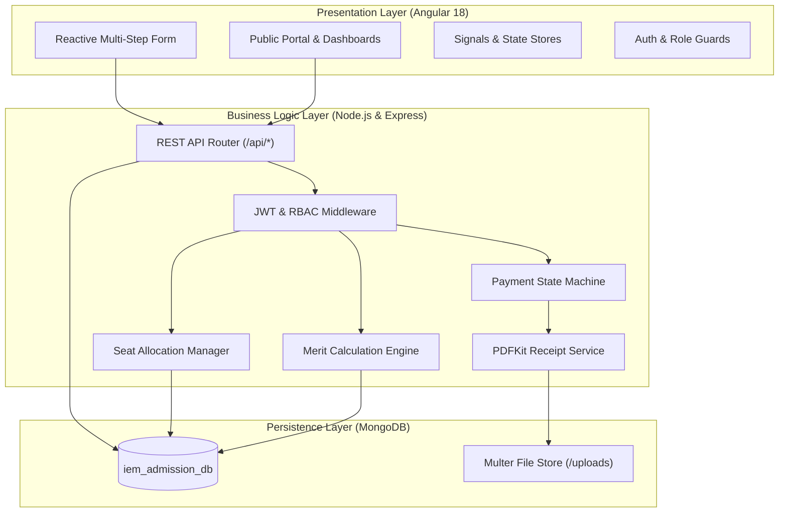

# IEM Admission Management System — Complete MEAN Stack Application

[](https://www.mongodb.com/mean-stack)
[](https://angular.dev/)
[](https://expressjs.com/)
[](https://mongoosejs.com/)
[](#)

A complete, full-stack, enterprise-grade university admission management portal developed for the **Software Engineering and Project Management (PCC-CS504)** laboratory project at the **Institute of Engineering & Management (IEM), Kolkata**.

> [!NOTE]
> **Academic Demonstration Project:** This portal is engineered exclusively for academic demonstration and laboratory evaluation. It simulates all admissions workflows, merit ranking engines, seat allocation quotas, and payment outcomes without processing real banking credentials or live admissions.

---

## 1. System Architecture & Features

The system strictly follows the **MEAN stack (MongoDB, Express.js, Angular, Node.js)** architecture with clear decoupling between presentation, business logic, and persistence layers.



### Key Functional Capabilities
1. **Student / Candidate Portal:**
   - Online registration and JWT-authenticated session management.
   - 4-step stepper admission form (Personal info, Academic scores with boundary checks, Document uploads, Final review).
   - Real-time 11-step progress tracker driven by live database state.
   - Multer file upload (PDF/JPG, max 4 MB) with automatic scrutiny queueing.
   - Document status scrutiny table with verifier remarks and replacement uploads.
   - Merit standings view with individual candidate highlighting.
   - Seat allotment review with countdown deadline.
   - Simulated payment modal (testing Successful, Failed, and Cancelled scenarios).
   - Printable and downloadable PDF provisional admission receipts via PDFKit.
   - In-app notification center.

2. **Document Verifier Workdesk:**
   - Role-restricted access to submitted application queue.
   - In-app certificate scrutiny and preview.
   - One-click approval or rejection with mandatory corrective remarks.
   - Verification history audit tracking.

3. **Administrator Directorate:**
   - Executive dashboard with admission KPIs and programme occupancy gauges.
   - Application directory with live search, filtering (status, quota, exam), sorting, and pagination.
   - Configurable merit ranking engine (configurable criteria: Entrance Rank, Class 12 Marks, Percentile; deterministic tie-breakers; allowed entrance exams).
   - Public merit list publishing with CSV export.
   - Seat capacity inventory management and atomic candidate seat allotment.
   - Analytics reports (Status breakdown, Scrutiny summary, Seat utilization, Fee transactions) with CSV export.

---

## 2. Technology Stack & Dependencies

| Component | Technology | Version | Purpose |
| :--- | :--- | :--- | :--- |
| **Frontend Framework** | Angular | 18.2 | Component architecture, Reactive Forms, Signals, Router |
| **Styling** | Tailwind CSS | 3.4 | Responsive, accessible, university-style visual design |
| **Backend Runtime** | Node.js | v18+ / v20+ | Server-side JavaScript execution |
| **API Framework** | Express.js | 4.21 | Modular REST API routing, middleware, controllers |
| **Database** | MongoDB | 6.0+ | Document persistence |
| **ODM Layer** | Mongoose | 8.9 | Schema enforcement, indexes, references, validation |
| **Authentication** | JWT & bcryptjs | 9.0 / 2.4 | Stateless tokens, secure password hashing |
| **File Handling** | Multer | 1.4 | Secure multipart upload validation |
| **PDF Generation** | PDFKit | 0.16 | High-fidelity vector PDF admission receipts |
| **Automated Testing** | Jest & Supertest | 29.7 / 7.0 | Automated unit, boundary, integration, and API tests |

---

## 3. Prerequisites & Environment Setup

Ensure the following tools are installed on your machine:
- **Node.js:** v18.0.0 or higher (`node -v`)
- **npm:** v9.0.0 or higher (`npm -v`)
- **MongoDB:** Community Server running locally on port 27017 or a MongoDB Atlas URI

### 3.1 Clone & Configure Environment Variables
Copy `.env.example` to `server/.env`:
```bash
cp .env.example server/.env
```

Ensure `server/.env` contains:
```env
# Server Configuration
PORT=5000
NODE_ENV=development

# Database Configuration
MONGODB_URI=mongodb://localhost:27017/iem_admission_db

# Security & JWT Authentication
JWT_SECRET=iem_admission_system_jwt_secret_academic_pcc_cs504_2026
JWT_EXPIRE=24h

# File Upload Configuration
UPLOAD_PATH=./uploads
MAX_FILE_SIZE_MB=4

# Client URL (for CORS)
CLIENT_URL=http://localhost:4200

# Optional Email Configuration (Disabled by default)
EMAIL_ENABLED=false
```

---

## 4. Installation & Database Seeding

### 4.1 Install Backend Dependencies
```bash
cd server
npm install
```

### 4.2 Install Frontend Dependencies
```bash
cd ../client
npm install
```

### 4.3 Seed the Database
Populate the database with programmes, seats, merit configurations, and diverse sample student lifecycle accounts:
```bash
cd ../server
npm run seed
```

---

## 5. Demonstration Accounts

The database seed utility creates pre-configured accounts representing every stage of the admissions workflow. You can log in with these credentials or use the **1-Click Evaluator Switcher** in the top navigation bar.

| Role / Lifecycle State | Email Address | Password | Scenario Demonstrated |
| :--- | :--- | :--- | :--- |
| **Administrator** | `admin@iemcal.edu` | `AdminPassword123!` | Complete administrative authority, merit calculation, seat allocation |
| **Document Verifier** | `verifier@iemcal.edu` | `VerifierPassword123!` | Certificate scrutiny, approval, rejection with remarks |
| **Student (Draft)** | `draft.student@iemcal.edu` | `StudentPassword123!` | Unsubmitted application, in-progress draft form |
| **Student (Under Review)** | `review.student@iemcal.edu` | `StudentPassword123!` | Form submitted, certificates waiting in scrutiny queue |
| **Student (Action Required)**| `rejected.doc@iemcal.edu` | `StudentPassword123!` | Rejected marksheets, replacement upload capability |
| **Student (Verified)** | `verified.student@iemcal.edu` | `StudentPassword123!` | 100% approved certificates, eligible for merit ranking |
| **Student (Allotted)** | `allotted.student@iemcal.edu` | `StudentPassword123!` | Seat allotted, ready to simulate fee payment |
| **Student (Paid)** | `paid.student@iemcal.edu` | `StudentPassword123!` | Fee verified and paid, ready to accept seat |
| **Student (Accepted)** | `accepted.student@iemcal.edu` | `StudentPassword123!` | Admission confirmed, view and download PDF receipt |
| **Student (Declined)** | `declined.student@iemcal.edu` | `StudentPassword123!` | Allotment declined, seat released back to inventory |

---

## 6. Running the Application

### 6.1 Start the Express Backend API
```bash
cd server
npm start
```
*Backend server will start at `http://localhost:5000`.*  
*Health Check: `http://localhost:5000/api/health`.*

### 6.2 Start the Angular Frontend
In a separate terminal window:
```bash
cd client
npm start
```
*Angular application will start at `http://localhost:4200`.*  
*Open your web browser and navigate to `http://localhost:4200`.*

---

## 7. Running Automated Tests

The backend test suite verifies **all 35 acceptance criteria** specified in Section 19 of the laboratory syllabus.

```bash
cd server
npm test
```

### Building Frontend for Production
```bash
cd client
npm run build
```

---

## 8. Complete Demonstration Walkthrough

Follow these steps to demonstrate the end-to-end admission workflow:

1. **Explore the Public Portal:**
   - Visit `http://localhost:4200`. Inspect the hero section, 4-step process guide, key dates, and available engineering courses.
   - Click **Programmes** to inspect course capacities and fee structures.
   - Click **Merit List** to view public category cutoffs.

2. **Register a New Student:**
   - Click **Apply for Admission (2026)** or navigate to `/auth/register`.
   - Register a new candidate (e.g., `Amit Sen`, `amit@example.com`, `9830099887`, `Password123!`).
   - Notice immediate redirect to the applicant dashboard.

3. **Fill Application Form & Upload Documents:**
   - Click **Continue Application Form**.
   - **Step 1:** Enter address, category, guardian details &rarr; Next.
   - **Step 2:** Enter Class 10/12 percentages and entrance rank &rarr; Next.
   - **Step 3:** Upload marksheets and rank card (PDF or JPG under 4 MB).
   - **Step 4:** Review summary, agree to declaration, and click **Submit Application Form**.
   - Notice the form locks into read-only mode and generates an official `IEM-2026-XXXX` ID.

4. **Document Scrutiny (Verifier):**
   - Click **Switch Demo Role** &rarr; Select **Document Verifier** (or sign in as `verifier@iemcal.edu`).
   - Locate the submitted application in the scrutiny workdesk and click **Inspect Certificates**.
   - Reject a document with a remark (e.g., *"Illegible scan"*).
   - Observe the candidate's status update to `Action Required`.

5. **Replacement Document Upload (Student):**
   - Switch back to the student account.
   - View the alert banner and verifier remark in the document status table.
   - Upload a replacement file; notice status changes to `Replacement Submitted`.

6. **Approval & Merit Generation (Admin):**
   - Switch to **Administrator** (`admin@iemcal.edu`).
   - Approve all pending documents.
   - Navigate to **Merit Engine** (`/admin/merit`). Select the programme and click **Calculate Merit (Preview)**.
   - Inspect rankings, tie-breakers, and category distributions.
   - Click **Publish Final List**. Candidates are now notified and merit-listed!

7. **Seat Allotment (Admin):**
   - Navigate to **Seat Allotment** (`/admin/seats`).
   - View capacity gauges and click **Allot Seat to Candidate**.
   - Assign an available quota seat to the eligible candidate.

8. **Simulated Payment & Seat Acceptance (Student):**
   - Switch to the student account and navigate to **Seat Allotment & Pay** (`/student/allotment`).
   - Notice the allotted seat identifier and required admission fee.
   - Click **Pay Admission Fee (Simulated)**.
   - In the payment modal:
     - Test **Simulate Failure** &rarr; Notice acceptance remains blocked and retry is offered.
     - Test **Simulate Successful Transaction** &rarr; Notice fee is marked paid.
   - The **Accept & Confirm Seat** button is now unlocked!
   - Click **Accept & Confirm Seat**.

9. **Official PDF Receipt Generation:**
   - Navigate to **Admission Receipt** (`/student/receipt`).
   - View the high-fidelity confirmation certificate.
   - Click **Download Official PDF** to download the vector PDF generated by the backend PDFKit engine.

---

## 9. Comprehensive Documentation Index

Additional detailed technical documentation is available in the [`docs/`](./docs) directory:
- [**Documentation Overview**](./docs/README.md)
- [**REST API Documentation**](./docs/API_DOCUMENTATION.md)
- [**Database Schema & Models**](./docs/DATABASE_SCHEMA.md)
- [**Software Test Plan**](./docs/TEST_PLAN.md)
- [**Traceable Test Results Log (TC-01 to TC-35)**](./docs/TEST_RESULTS.md)

---

## 10. Troubleshooting & FAQ

- **MongoDB connection refused (`ECONNREFUSED 127.0.0.1:27017`):**  
  Ensure MongoDB service is running via Windows Services or run `mongod` in a terminal.
- **Port 5000 or 4200 in use:**  
  Change `PORT` in `server/.env` or start Angular with `ng serve --port 4300`.
- **Resetting Database to Clean Demo State:**  
  Run `npm run seed` in `/server` to safely reset and re-seed all sample data.

---

## 11. Cloud Deployment Guide (Render + MongoDB Atlas)

The project is fully configured for one-click deployment on **Render** (as a unified full-stack MEAN web service serving the Angular frontend and Node.js REST API together).

### Step 1: Set Up Free Cloud MongoDB (MongoDB Atlas)
1. Sign up / Log in to [MongoDB Atlas](https://www.mongodb.com/cloud/atlas).
2. Create a free **M0 Shared Cluster** (AWS / any region).
3. Under **Security &rarr; Database Access**, create a user (e.g. `iem_admin`) and password.
4. Under **Security &rarr; Network Access**, add IP `0.0.0.0/0` (Allow access from anywhere).
5. Click **Connect &rarr; Drivers (Node.js)** and copy your connection string:
   ```text
   mongodb+srv://iem_admin:<password>@cluster0.xxxxx.mongodb.net/iem_admission_db?retryWrites=true&w=majority
   ```

### Step 2: Deploy on Render
1. Sign in to [Render Dashboard](https://dashboard.render.com).
2. Click **New + &rarr; Web Service**.
3. Connect your GitHub repository: `Subho7439/iem-admission-system`.
4. Configure the settings:
   - **Name:** `iem-admission-system`
   - **Environment:** `Node`
   - **Branch:** `main`
   - **Build Command:** `npm run build`
   - **Start Command:** `npm start`
5. Under **Environment Variables**, add:
   - `NODE_ENV` = `production`
   - `MONGODB_URI` = `mongodb+srv://iem_admin:<password>@cluster0.xxxxx.mongodb.net/iem_admission_db?retryWrites=true&w=majority`
   - `JWT_SECRET` = `iem_admission_jwt_secret_render_production_2026`
6. Click **Deploy Web Service**!
7. Once deployed, open the **Shell** tab in Render and run:
   ```bash
   npm run seed
   ```
   This will immediately initialize all sample courses, seats, demo applicants, and admin credentials on your live cloud database!

---

## 12. Authors & Lab Credits

- **Course:** Software Engineering and Project Management Laboratory (PCC-CS504)
- **Institution:** Department of Computer Science & Engineering, Institute of Engineering & Management, Kolkata
- **Academic Year:** 2026–2027


- **Live Link:** https://iem-admission-system-tcwf.onrender.com/
