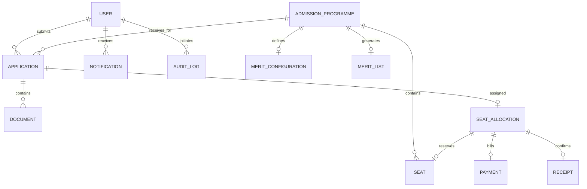

# IEM Admission Management System — Database Schema & Data Models

**Database Engine:** MongoDB 6.0+  
**ODM Layer:** Mongoose 8.9.5  
**Database Name:** `iem_admission_db`  
**Data Integrity Paradigm:** Strict schema types, field regex validators, unique indexing, embedded subdocuments, and conditional atomic state transitions.

---

## 1. Entity-Relationship Overview

---

## 2. Core Collections & Schema Specifications

### 2.1 User Collection (`users`)
Stores system identities across Student, Administrator, and Document Verifier roles.

| Field | Type | Constraints | Description |
| :--- | :--- | :--- | :--- |
| `name` | String | Required, Trim, Max: 100 | Full legal name |
| `email` | String | Required, Unique, Lowercase, Regex | Institutional or candidate email |
| `mobile` | String | Required, Regex `^[6-9]\d{9}$` | 10-digit Indian mobile number |
| `password` | String | Required, Min: 6, `select: false` | Bcrypt hashed password |
| `role` | String | Enum: `student`, `admin`, `verifier` | Role-based authorization tag |
| `dob` | Date | Optional | Date of birth |
| `isActive` | Boolean | Default: `true` | Account active state |
| `lastLogin` | Date | Optional | Timestamp of last authenticated session |

**Indexes:**
- `{ email: 1 }` (Unique)

---

### 2.2 AdmissionProgramme Collection (`admissionprogrammes`)
Defines degree courses, intake quotas, fee schedules, and academic cutoff rules.

| Field | Type | Constraints | Description |
| :--- | :--- | :--- | :--- |
| `code` | String | Required, Unique, Uppercase | Programme code (e.g. `CSE`, `IT`, `ECE`) |
| `name` | String | Required | Full programme name |
| `degree` | String | Required, Default: `B.Tech` | Degree level |
| `durationYears` | Number | Required, Default: `4` | Course duration |
| `totalSeats` | Number | Required, Min: 1 | Total seat capacity |
| `seatsByCategory`| Object | `{ GENERAL: Number, OBC: Number, SC: Number, ST: Number }` | Quota distribution |
| `admissionFee` | Number | Required | One-time admission/confirmation fee |
| `semesterFee` | Number | Required | Semester tuition fee |
| `eligibility` | Object | `{ minClass12Percentage, allowedExams: [String], maxEntranceRank }` | Entrance cutoff rules |
| `isActive` | Boolean | Default: `true` | Admission round availability |

---

### 2.3 Application Collection (`applications`)
Central aggregate root tracking a candidate's complete admission lifecycle.

| Field | Type | Constraints | Description |
| :--- | :--- | :--- | :--- |
| `applicationId` | String | Required, Unique | Unique institutional ID (`IEM-2026-XXXX`) |
| `user` | ObjectId | Ref: `User`, Required | Associated applicant |
| `programme` | ObjectId | Ref: `AdmissionProgramme`, Required | Selected course |
| `admissionCycle`| String | Required, Default: `2026-2027` | Academic admissions year |
| `status` | String | Enum (see Status Enums below) | Current application milestone |
| `isDraft` | Boolean | Default: `true` | Draft vs locked state flag |
| `submissionDate`| Date | Optional | Timestamp of final declaration |
| `personalInfo` | Subdocument | Address, Category (`GENERAL`, `OBC`, `SC`, `ST`), Guardian | Embedded candidate personal details |
| `academicInfo` | Subdocument | 10th %, 12th %, Exam (`WBJEE`, `JEE Main`), Rank, Percentile | Embedded academic scores |
| `isDocumentVerified`| Boolean | Default: `false` | True only when all mandatory docs approved |
| `isEligible` | Boolean | Default: `false` | Merit calculation qualification |
| `meritPosition`| Number | Optional | Overall programme merit rank |
| `categoryMeritPosition`| Number | Optional | Quota-specific merit rank |

**Indexes:**
- `{ applicationId: 1 }` (Unique)
- `{ user: 1 }`
- `{ status: 1 }`
- `{ programme: 1 }`

---

### 2.4 Document Collection (`documents`)
Manages individual uploaded certificates, verifier scrutiny statuses, and audit history.

| Field | Type | Constraints | Description |
| :--- | :--- | :--- | :--- |
| `application` | ObjectId | Ref: `Application`, Required | Parent application reference |
| `user` | ObjectId | Ref: `User`, Required | Candidate reference |
| `documentType`| String | Enum: Marksheets, Photo, Signature, Rank Card | Category of certificate |
| `originalName`| String | Optional | Candidate's local filename |
| `fileName` | String | Optional | Server filesystem sanitized filename |
| `filePath` | String | Optional | Path to file storage |
| `mimeType` | String | Optional (PDF, JPG, PNG) | MIME type |
| `fileSize` | Number | Max: 4194304 bytes (4 MB) | Binary size in bytes |
| `status` | String | Enum (see Status Enums below) | Verification scrutiny state |
| `isRequired` | Boolean | Default: `true` | Mandatory vs optional |
| `verifierRemarks`| String | Optional | Justification when rejected |
| `verifiedAt` | Date | Optional | Timestamp of verifier decision |
| `history` | Array | Array of `{ status, remarks, fileName, timestamp }` | Verification audit timeline |

---

### 2.5 Seat & SeatAllocation Collections (`seats`, `seatallocations`)
Governs seat capacity inventory and provisional allotment locks.

#### `seats` Schema:
- `seatIdentifier`: String (Unique, e.g. `CSE-GEN-01`, `IT-OBC-02`)
- `programme`: Ref `AdmissionProgramme`
- `category`: Enum (`GENERAL`, `OBC`, `SC`, `ST`)
- `status`: Enum (`Available`, `Allotted`, `Accepted`, `Declined`, `Expired`)
- `allottedTo`: Ref `Application` (Optional)
- `allottedAt`: Date (Optional)

#### `seatallocations` Schema:
- `application`: Ref `Application`
- `student`: Ref `User`
- `seat`: Ref `Seat`
- `programme`: Ref `AdmissionProgramme`
- `category`: String
- `feeAmount`: Number
- `allotmentDate`: Date
- `acceptanceDeadline`: Date (Enforces expiration checks)
- `status`: Enum (`Allotted`, `Accepted`, `Declined`, `Expired`)
- `acceptedAt` / `declinedAt`: Date (Optional)

---

### 2.6 Payment & Receipt Collections (`payments`, `receipts`)
Simulates the academic payment gateway state machine and issues confirmation receipts.

#### `payments` Schema:
- `transactionReference`: String (Unique, e.g. `TXN-IEM-2026-XXXX`)
- `application`: Ref `Application`
- `allocation`: Ref `SeatAllocation`
- `amount`: Number
- `paymentMethod`: String (`NetBanking_Demo`, `UPI_Demo`, `Card_Demo`)
- `status`: Enum (`Not Initiated`, `Pending`, `Successful`, `Failed`, `Cancelled`)
- `failureReason`: String (Optional)
- `completedAt`: Date
- `retryCount`: Number (Default: 0)

#### `receipts` Schema:
- `receiptNumber`: String (Unique, e.g. `RCP-IEM-2026-XXXX`)
- `application`: Ref `Application`
- `candidateName`: String
- `programmeName` / `programmeCode`: String
- `category`: String
- `seatIdentifier`: String
- `amountPaid`: Number
- `paymentReference`: String
- `admissionCycle`: String
- `issuedAt`: Date
- `pdfPath`: String (Location of PDFKit generated receipt)

---

## 3. Enumerations & State Transitions

### Application Lifecycle Statuses:
`Draft` &rarr; `Submitted` &rarr; `Under Review` &rarr; `Action Required` (if docs rejected) &rarr; `Verified` &rarr; `Eligible` &rarr; `Merit Listed` &rarr; `Seat Allotted` &rarr; `Accepted` / `Declined`

### Document Verification Statuses:
`Not Uploaded` &rarr; `Pending` &rarr; `Under Review` &rarr; `Approved` / `Rejected` &rarr; `Replacement Submitted`

### Payment Statuses:
`Not Initiated` &rarr; `Pending` &rarr; `Successful` (Unlocks Acceptance) / `Failed` (Allows Retry) / `Cancelled`
